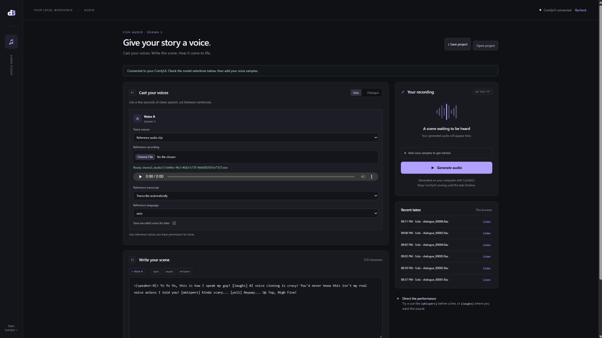

# Drama 3 Audio Studio for ComfyUI

A local browser interface for **Fish Audio Drama 3 speech generation**, powered by [PedroMarinhoDev/ComfyUI-Drama3](https://github.com/PedroMarinhoDev/ComfyUI-Drama3).

Upload a voice reference, write a script, generate a recording, and play or download the result. The Studio opens from **ComfyUI → Extensions → Open Audio Studio**. ComfyUI and your installed models do the generation on your computer.

**Built with Fish Audio.** This is an independent frontend project, not an official Fish Audio or ComfyUI release.



*Screenshot from an actual local test session. The microphone recording and generated audio shown in the interface are not included in this repository.*

> **Hardware matters.** This is a small frontend for a large model. Check [Verified requirements and realistic expectations](#verified-requirements-and-realistic-expectations) near the end **before downloading tens of gigabytes**. An RTX 5080 with 16 GB VRAM and 32 GB system RAM needed a memory workaround during the initial test.

## What is included

- One-voice **Solo** and two-voice **Dialogue** modes.
- Reference-audio upload and playback.
- Typed reference transcripts, or optional Qwen3-ASR transcription.
- Speaker-tag and performance-cue buttons.
- Model menus populated from your running ComfyUI.
- Generation settings, seed controls, queue monitoring, and reconnect handling.
- Audio playback, download links, and a list of recent takes.
- Project JSON save/load and optional encoded-voice reuse.
- An **Open Audio Studio** command in ComfyUI's Extensions menu.

This repository contains the frontend, its small ComfyUI page-serving add-on, documentation, and tests. **Download the model weights and the separate Drama 3 node pack yourself.** The Studio does not train a voice, install models, supply a hosted generation service, or include the upstream timeline editor. Its UI exposes two voices even though the underlying model supports more.

## Before you start

You need three things installed on the **same computer**:

1. **ComfyUI** — the application that runs the AI nodes.
2. **ComfyUI-Drama3** — the separate node pack that runs Drama 3.
3. **Drama 3 model files** — one compatible model and its codec.

An ASR model is optional: type the reference transcript yourself to start without it. A **reference transcript** means the words spoken in your uploaded recording. The **script** means the new words you want the AI to say.

You do **not** need Node.js, npm, a separate web server, or a paid API key to use this frontend. Developer tests use Node.js, but installation does not.

## Installation, step by step

### 1. Install and open ComfyUI

Already have a working ComfyUI installation? Keep it and move to step 2.

For a new Windows installation, use the [official ComfyUI download page](https://www.comfy.org/download) and [Comfy Desktop Windows instructions](https://docs.comfy.org/installation/desktop/windows). Choose a **local** installation so generation runs on your computer. Start ComfyUI once and wait until its normal workflow interface opens. A paid Comfy Cloud subscription is not needed for this local project.

Other installation choices are documented in the [Windows Portable guide](https://docs.comfy.org/installation/comfyui_portable_windows) and [manual installation guide](https://docs.comfy.org/installation/manual_install). Use a ComfyUI build compatible with your GPU and the Drama 3 nodes. Installing ComfyUI successfully does not by itself establish that Drama 3 will fit in memory.

### 2. Find the correct ComfyUI folder

Find the folder containing **`custom_nodes`**, **`models`**, **`input`**, and **`output`**. Throughout this README, **“your ComfyUI folder”** means this folder.

- **Comfy Desktop:** select your local installation in the launcher. Its Manage/Storage tools can show the instance location. Desktop locations vary: use the actual instance you launch, not a similarly named Downloads folder.
- **Windows Portable:** usually open `ComfyUI_windows_portable`, then open the **`ComfyUI`** folder inside it.
- **Manual installation:** use the checkout containing `main.py` and `custom_nodes`.

**Stop ComfyUI before copying add-on folders.** Stop its server/instance, not just its browser tab. Leave your file-browser window open at the ComfyUI folder.

### 3. Install the separate Drama 3 engine

Open [ComfyUI-Drama3 on GitHub](https://github.com/PedroMarinhoDev/ComfyUI-Drama3). This is the engine dependency; it is a different project from Audio Studio.

1. Click **Code → Download ZIP**. Windows: right-click the download and choose **Extract All**.
2. Find the extracted folder containing the engine's `__init__.py`, `nodes.py`, and `drama3` folder.
3. Rename that folder to **`ComfyUI-Drama3`** if you want the same name used here.
4. Copy that entire folder into **your ComfyUI folder → `custom_nodes`**.

The engine's entry file should now be:

```text
ComfyUI/custom_nodes/ComfyUI-Drama3/__init__.py
```

The reviewed upstream version says its native nodes need no additional Python packages beyond ComfyUI's environment. Follow that project's own instructions if a future version changes this. Use the exact PedroMarinhoDev pack; similarly named Drama 3 or Qwen packs are not necessarily interchangeable. The reviewed current pack includes its own native Qwen3-ASR nodes.

For preservation, [Sources and versions](docs/SOURCES.md) records the engine commit reviewed for this release and a link to its fixed-version ZIP. The original installation's exact engine commit was not captured.

### 4. Install this Audio Studio frontend

1. On **this repository's GitHub page**, click **Code → Download ZIP**, then extract it. Alternatively, extract the prepared Audio Studio release ZIP.
2. Open the extracted folder. Locate the directory that **directly contains `__init__.py`, `web`, `extension`, and this `README.md`**.
3. Rename that directory to **`drama3_audio_studio`**.
4. Copy it into **your ComfyUI folder → `custom_nodes`**, beside the engine folder.

These three paths must exist:

```text
ComfyUI/custom_nodes/drama3_audio_studio/__init__.py
ComfyUI/custom_nodes/drama3_audio_studio/extension/audio_studio.js
ComfyUI/custom_nodes/drama3_audio_studio/web/index.html
```

**Avoid double nesting:** `custom_nodes/drama3_audio_studio/drama3_audio_studio/__init__.py` is one folder too deep. The public release puts its installable files at the repository root to make this easier.

This public layout differs from early private bundles: `README.md`, `__init__.py`, `web`, and `extension` are now at the same level. For an update, stop ComfyUI and replace the old add-on folder with this complete folder. Keep a backup outside `custom_nodes` if desired. Do not leave two installed copies of Audio Studio, because they register the same page routes.

You can keep the original ZIP in Downloads or delete that downloaded ZIP later. **The copied folders must remain in `custom_nodes`.**

### 5. Download the model and codec

Use the **ComfyUI-converted files** from the node-pack author's [Drama 3 model repository](https://huggingface.co/PedroMarinhoDev/Drama-3-ComfyUI/tree/main). The original Fish Audio checkpoint is linked for attribution, but its format is not a drop-in substitute for these files.

Choose **one** model according to your available RAM; do not download every model to begin. The W4 model was used in the 32 GB test. Larger model choices and their RAM estimates are listed [near the end](#verified-requirements-and-realistic-expectations).

| Download | Put the file here, inside your ComfyUI folder |
| --- | --- |
| [W4 model: `drama3_w4a8experts_bf16.safetensors`](https://huggingface.co/PedroMarinhoDev/Drama-3-ComfyUI/blob/main/drama3_w4a8experts_bf16.safetensors) — one possible starting choice | `models/diffusion_models` |
| [Codec: `drama3_codec.safetensors`](https://huggingface.co/PedroMarinhoDev/Drama-3-ComfyUI/blob/main/drama3_codec.safetensors) — required with every model | `models/vae` |
| [Qwen3-ASR 0.6B: `qwen3_asr_0.6b_bf16.safetensors`](https://huggingface.co/PedroMarinhoDev/Qwen3-ASR-ComfyUI/blob/main/qwen3_asr_0.6b_bf16.safetensors) — optional | `models/asr` |

On Hugging Face, open the file page and use its download control. Save the actual multi-gigabyte file, not the webpage or a tiny Git LFS pointer. Keep the `.safetensors` filename. Create a missing destination folder, such as `asr`, yourself. These files are not ZIP archives and do not need extraction.

For automatic transcription, the current native nodes can use either the [0.6B or 1.7B ASR file](https://huggingface.co/PedroMarinhoDev/Qwen3-ASR-ComfyUI/tree/main). **The forced-aligner file is not a speech-transcription model and is not needed by this frontend.**

### 6. Restart and open Audio Studio

1. Start ComfyUI using your usual launcher or shortcut and wait for it to finish starting.
2. **Keep ComfyUI running.** Refresh its normal browser tab; use **Ctrl+F5** on Windows if the menu does not update.
3. In the main menu, choose **Extensions → Open Audio Studio**. It opens a new browser tab.
4. Wait for **ComfyUI connected**, then open **Models & generation settings** and check your model/codec selections.

The direct address is your existing ComfyUI address plus **`/drama3-audio-studio`**. For example:

- ComfyUI at `http://127.0.0.1:8188` → `http://127.0.0.1:8188/drama3-audio-studio`
- ComfyUI at `http://127.0.0.1:8000` → `http://127.0.0.1:8000/drama3-audio-studio`

The included `Open_Audio_Studio.url` shortcut assumes port **8188**. The Extensions menu automatically uses the current address. Open Studio through ComfyUI, not by double-clicking `web/index.html`. Leave the installed `__init__.py` alone: ComfyUI imports it during startup.

You do **not** need to load a graph onto the ComfyUI canvas. The Studio submits its own equivalent audio job through ComfyUI's API.

## First test: one short recording

1. Select **Solo**.
2. Keep **Voice source → Reference audio clip**. Upload a short, clear recording of a voice you have permission to use. Wait for the green **Ready** filename. Press its Play button to confirm the right clip is available.
3. Set **Reference transcript → Type the transcript myself**. In **Words spoken in the clip**, enter exactly what was said, including extra words. This first test bypasses ASR.
4. In **Write your scene**, enter `Hello. This is a short voice test.` Start without emotion cues to make comparison easier.
5. Open **Models & generation settings** and select the installed Drama 3 model and codec. Use this starting configuration:

   | Control | First-test value |
   | --- | --- |
   | Expert placement | **in RAM** |
   | Expert cache (GB) | **1** |
   | Second GPU | **none** |
   | GPU split layer | **0** |
   | Temperature | **1** |
   | Top P | **0.9** |
   | Top K | **0** |
   | Maximum frames per chunk | **600** |

   The page may initially show expert cache **0**, meaning automatic. Enter **1** for this conservative test. The cache is only part of total GPU memory use. This is a starting point, not a guarantee of fitting.

6. Click **Generate audio** once. Allow time for the large model to load. Leave ComfyUI running; check its console if the page appears stalled.
7. When the take finishes, play it and use its **Download** link. Audio also remains in `ComfyUI/output/drama3` with the default output prefix. The installed `SaveAudio` node determines the file format; the initial test produced FLAC.

If you get the pinned-memory error described below, follow [the targeted workaround](#pinned-memory-error-the-workaround-that-helped-in-testing), restart, then repeat this test.

## Everyday use

**Dialogue:** choose Dialogue, provide Voice A and Voice B, then begin every nonempty script line with `<|speaker:0|>` or `<|speaker:1|>`. The A/B buttons insert the tags. **Load example** supplies a short fictional exchange.

**Delivery:** cues such as `[laughs]`, `[sighs]`, and `[whispers]` are sent to the model as part of the script. Start with a natural reference in the style you want. Results depend on the model, reference, transcript, and seed. A successful generation is not a guarantee that a clone will closely resemble the source speaker.

**Automatic transcripts:** after the first test works, choose Transcribe automatically and select your ASR model under settings. The current upstream native loader exposes a `.safetensors` filename. Older compatible Qwen loaders may expose a model ID and additional controls instead. This frontend reads the installed definitions; it does not guarantee compatibility with every third-party ASR implementation using similar node names. The automatically generated transcript is not currently displayed for correction; switch to a typed transcript to control it directly.

**Reference length:** use a clean, manageable clip cut at sentence boundaries. A 15–20 second reference is a useful experiment if a very short clip is not representative; longer clips cost more processing and do not guarantee better resemblance. Keep the transcript exact. Recordings are not included inside saved project JSON.

**Reuse a voice:** tick Save encoded voice for later before generating. After a successful run, click Recheck, change Voice source to Previously saved voice, and select the saved entry. The engine stores these files in `output/drama3_voices`. This requires its save/load voice nodes.

**Projects:** Save project downloads the script, settings, seed, and input filenames. Open project restores those settings. Keep the source files too; their names only work while the referenced inputs still exist in that ComfyUI instance. Project files and take details are different from a ComfyUI canvas workflow.

**Recent takes:** this browser keeps up to 12 entries. Browser storage, ComfyUI history, and files on disk are separate. Clearing browser data can remove this list without deleting saved audio. After a page refresh, use Listen on a recent entry to reopen its player.

**Queues:** closing Studio does not cancel an already submitted job. The same browser/address attempts to resume checking a stored prompt ID. A lost submission response can require checking the ComfyUI queue and output folder before submitting again. Use ComfyUI's own queue controls to cancel work. Avoid also queuing the canvas workflow for the same take.

## Troubleshooting

### Pinned-memory error: the workaround that helped in testing

In the initial test, `Drama3Loader` failed while calling:

```python
torch.empty(..., pin_memory=True)
```

That allocation is **page-locked host/system RAM** used by CUDA. A CUDA out-of-memory message here does not establish that the GPU's dedicated VRAM is full. The reference loaded and encoded first; model loading then failed. Reducing the GPU expert cache to 1 GB did not fix that loading step on its own.

Adding ComfyUI's documented **`--disable-pinned-memory`** startup flag allowed the test to complete. The reviewed Drama 3 source respects this flag and uses a different path. It may run more slowly. This workaround changes the whole ComfyUI instance until the flag is removed; it is not automatically enabled by Audio Studio and is not a guarantee of fitting in RAM.

**Comfy Desktop:**

1. In the launcher, select your local installation and open **Manage → Startup Args**. The home-screen instance card's **⋮ → Manage** menu is another route.
2. Add `--disable-pinned-memory` to **Startup Arguments**, separated from existing flags by a space. Keep the arguments already there. For example, if the field currently contains `--enable-manager`, the result is:

   ```text
   --enable-manager --disable-pinned-memory
   ```

3. Click outside the field, apply/save if offered, and restart the instance.
4. Reopen Studio, keep experts in RAM and cache 1 GB, and retry the short test.

**Windows Portable:** stop ComfyUI, right-click your usual GPU `.bat` launcher and choose Edit, and add `--disable-pinned-memory` to the existing Python command **after `main.py`**, separated by a space. Save, then run that launcher again. Preserve the existing Python path and other arguments.

**Manual launch:** append the same flag to your normal launch command, for example `python main.py --disable-pinned-memory`, using the Python environment already used for your ComfyUI installation.

[ComfyUI startup flag reference](https://docs.comfy.org/development/comfyui-server/startup-flags) · [Desktop Startup Args instructions](https://docs.comfy.org/installation/desktop/usage/manage#startup-args-tab)

To undo this test, remove only that added flag and restart ComfyUI. Do not use an arbitrary “pinned memory fix” copied into model source files.

### Other common problems

| Symptom | What to check |
| --- | --- |
| Menu item is missing | Confirm `__init__.py`, `web`, and `extension` are directly inside the installed add-on folder. Restart the server, hard-refresh the browser, and check that the launcher extension is enabled. |
| Direct URL gives 404 | Confirm you installed into the ComfyUI instance actually running. Check its startup console for `[Drama 3 Audio Studio]` or an import error. |
| Missing nodes | Install/enable the exact engine pack linked above. Frontend installation alone does not provide the generation nodes. |
| Model selection is empty or incorrect | Check file location, actual file size, and filename. Restart or refresh the model lists, click Recheck, and select compatible weights and codec. |
| ASR fails | Use typed reference transcripts for every active clip voice, then check your ASR node version and model selection. |
| No file chosen appears next to the upload button after upload | The file-picker control is rebuilt. The green Ready path is the stored filename; use the reference player's Play button to verify the clip. |
| Reference player initially shows 0:00 | Its audio is loaded on demand. Try Play. If playback fails, check that the input still exists and the upload completed. |
| Upload is rejected | Try a conventional WAV recording; check its size against ComfyUI's configured upload limit and read the console error. |
| CUDA memory error at a different line | Read the entire traceback. The pinned-memory workaround is specific to one failure; another stage may actually exhaust VRAM. |
| RAM approaches 100% or generation becomes very slow | Close other large applications before the next test. Your system may be under memory pressure. A larger pagefile does not create more physical RAM or make page-locked allocations fit. |
| Voice sounds wrong or a take falls silent | Check the complete reference transcript, try a different clean stretch of speech, and compare multiple seeds. Keep temperature 1, Top P 0.9, and Top K 0 for the starting test. |
| A listed take will not play | Keep ComfyUI running and check whether the output file was moved or deleted. Find it in the output folder. |
| A project cannot find its clip | Reupload the source audio on this instance. Project JSON contains filenames, not the actual recordings. |

If asking for help, include the failing node name, the full traceback with personal paths removed, selected model, cache/placement settings, ComfyUI and node-pack versions, GPU/VRAM, and system RAM. A generic CUDA error alone cannot identify the allocation that failed. See the [bug report template](.github/ISSUE_TEMPLATE/bug_report.md).

## Verified requirements and realistic expectations

**Checked against upstream sources on October 21, 2026.** These are requirements for **PedroMarinhoDev's converted ComfyUI models and node pack**. Do not assume they describe every other deployment of the original Fish Audio model. See the [reviewed sources and engine revision](docs/SOURCES.md).

### Upstream baseline

The node-pack maintainer specifies **ComfyUI 0.40 or newer**, an **NVIDIA GPU with at least 8 GB VRAM** when experts are offloaded to RAM, and RAM that scales with the chosen weights. Its smaller-VRAM measurements used a 24 GB RTX 3090 with memory deliberately occupied to simulate 8/12 GB conditions; those tests are not validation of every smaller card or Windows setup. The maintainer's benchmark machine had **188 GB system RAM**.

| Converted model | Approximate model download | Maintainer's approximate system RAM requirement |
| --- | ---: | ---: |
| [W4A8](https://huggingface.co/PedroMarinhoDev/Drama-3-ComfyUI/blob/main/drama3_w4a8experts_bf16.safetensors) | 24.6 GB | 32 GB |
| [W6A8](https://huggingface.co/PedroMarinhoDev/Drama-3-ComfyUI/blob/main/drama3_w6a8experts_bf16.safetensors) | 32.7 GB | 40 GB |
| [FP8](https://huggingface.co/PedroMarinhoDev/Drama-3-ComfyUI/blob/main/drama3_fp8experts_bf16.safetensors) | 38.6 GB | 48 GB |
| [INT8](https://huggingface.co/PedroMarinhoDev/Drama-3-ComfyUI/blob/main/drama3_int8experts_bf16.safetensors) | 38.7 GB | 48 GB |

Add the **1.6 GB codec** download to every model. Optional ASR adds **1.6 GB for 0.6B** or **4.1 GB for 1.7B** on disk. ASR file size is not an exact statement of runtime memory use. The W4 model plus codec is approximately **26.2 GB on disk**, before ComfyUI, its Python environment, temporary downloads, optional ASR, and generated recordings. Leave additional SSD space for these; the 26 GB upstream figure is not a full-installation disk budget.

Sources: [node-pack Requirements](https://github.com/PedroMarinhoDev/ComfyUI-Drama3#requirements), [converted Drama 3 model card](https://huggingface.co/PedroMarinhoDev/Drama-3-ComfyUI), [converted Qwen3-ASR model card](https://huggingface.co/PedroMarinhoDev/Qwen3-ASR-ComfyUI).

The original model is a 35B-parameter mixture-of-experts architecture, with a smaller active subset per step. This does not make its stored weights small. This frontend does not compress the weights or reduce the engine's minimum RAM/VRAM. Its native CUDA path is the supported scope here; **CPU-only, AMD-only, and Apple Silicon inference have not been established for this project**. The fact that ComfyUI itself supports additional backends does not establish that this particular engine does.

### What happened on the first real test PC

| Item | Observed configuration or outcome |
| --- | --- |
| OS/application | Windows; Comfy Desktop |
| GPU | NVIDIA GeForce RTX 5080, 16 GB dedicated VRAM |
| System memory | 32 GB installed, approximately 31.1 GB usable |
| Model | W4A8, experts in RAM; cache set to 1 GB for the working test |
| Initial failure | Pinned host-memory allocation in `Drama3Loader` |
| Workaround that allowed generation | `--disable-pinned-memory`, followed by a restart |
| Memory during one generation screenshot | Approximately 30.5/31.1 GB RAM (98%), 12.2/16 GB dedicated VRAM, 0.4 GB shared GPU memory |
| Result | End-to-end audio generation and the Extensions menu launcher worked. The tester reported poor voice resemblance. |

Those numbers are a **single-session observation**, not a measured peak or a performance guarantee. The exact installed ComfyUI, PyTorch, and engine versions were not captured. A powerful GPU did not remove the system-RAM constraint. Other machines may fail earlier or behave differently.

### Practical planning advice from this frontend project

- **32 GB RAM:** a constrained starting point for W4. The initial PC reached 98% usage and needed a workaround. Expect little room for other applications.
- **64 GB RAM:** our practical target for regular use, with room to consider less heavily quantized weights and ordinary background applications. This is our recommendation, not a new official minimum.
- **96–128 GB RAM:** additional headroom if your wider workflow keeps several large tools open; not a requirement for this frontend alone.
- **Under 32 GB system RAM, under 8 GB NVIDIA VRAM, or an unsupported backend:** outside the reviewed engine's stated baseline. Do not expect this Studio to make the model fit. Consider a smaller, compatible TTS model in a different workflow or suitable remote hardware rather than assuming more retries will help.

More system RAM does not increase dedicated GPU VRAM or guarantee voice-cloning quality. Keep RAM, VRAM, model size on disk, and GPU activity percentage separate when diagnosing resource limits.

## Preservation, development, and test status

This is the **v0.1.0 public preservation release**. Single-voice generation and the menu launcher were confirmed in the local Windows test described above. Dialogue, saved-voice reuse, and schema adaptation have automated graph coverage but have not all been confirmed end to end on that same PC. Automatic-transcription quality and voice similarity are not certified.

The frontend is buildless HTML/CSS/JavaScript plus a small Python route module. It calls ComfyUI's same-origin `/object_info`, `/upload/image`, `/prompt`, `/queue`, `/history`, and `/view` APIs. Uploaded audio uses ComfyUI's generic upload route; the endpoint name is `/upload/image` even for these audio bytes. No models or voices are uploaded to this project's own service. Your selected upstream ASR implementation may download models when configured to use remote model sources.

The original supplied canvas graph is preserved as [examples/Audio_AI_TTS.workflow.json](examples/Audio_AI_TTS.workflow.json) and as `web/workflow.json`. It uses historical Qwen widget definitions, refers to example input filenames you must replace, and contains a legacy transcript-widget mismatch. It is an archival reference, not an alternative first-run path guaranteed to work unchanged on current nodes. The Studio builds its API graph from installed node schemas, prunes unused branches, and uses the save node's output for playback.

For source layout, checks, and how to create another release ZIP, see [CONTRIBUTING.md](CONTRIBUTING.md). To put this prepared project on GitHub, see [PUBLISHING.md](PUBLISHING.md). [CHANGELOG.md](CHANGELOG.md) records this release; [docs/SOURCES.md](docs/SOURCES.md) records the reviewed dependencies. The documented upstream engine revision was reviewed, not a reconstruction of the tester's unknown installed versions.

## Credits and licenses

- **Fish Audio:** original [Drama 3 model](https://huggingface.co/fishaudio/drama-3), codec, and [Fish Speech](https://github.com/fishaudio/fish-speech). Built with Fish Audio.
- **PedroMarinhoDev:** [ComfyUI-Drama3](https://github.com/PedroMarinhoDev/ComfyUI-Drama3), the native engine, converted model files, offloading, and native ASR integration.
- **Qwen team:** [Qwen3-ASR](https://github.com/QwenLM/Qwen3-ASR), used for optional reference transcription.
- **ComfyUI contributors:** [ComfyUI](https://github.com/Comfy-Org/ComfyUI) and its extension/server APIs.

The Audio Studio code is released under **GPL-3.0-or-later**; see [LICENSE](LICENSE). External model weights, codec files, engine components, and their outputs retain their own upstream terms. In particular, Drama 3 is distributed under the **Fish Audio Community License**, while the converted Qwen3-ASR repository identifies **Apache-2.0**. Review the actual linked licenses before commercial or hosted use; the frontend's code license does not grant additional model rights. See [THIRD_PARTY_NOTICES.md](THIRD_PARTY_NOTICES.md).

Use only reference voices you have permission to use. This repository includes no personal voice samples or private generated recordings.
